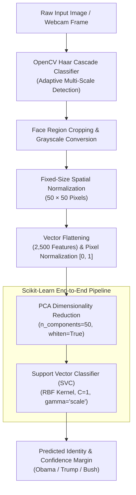

# 👤 Facial Recognition System using PCA & Support Vector Machines (SVM)

[](https://www.python.org/)
[](https://scikit-learn.org/)
[](https://opencv.org/)
[](https://share.streamlit.io/)
[](LICENSE)

An end-to-end computer vision and machine learning pipeline that detects, extracts, and classifies facial identities using **Haar Cascade Classifiers**, **Principal Component Analysis (Eigenfaces)** for dimensionality reduction, and an **RBF-kernel Support Vector Machine (SVM)** for multi-class classification. Includes a real-time **Streamlit web application** with live confidence margins, adaptive face detection, and one-click cloud deployment.

---

## 🎯 Target Identities
The model is trained on facial features of three public figures:
- **Barack Obama** (Label `0`)
- **Donald Trump** (Label `1`)
- **George W. Bush** (Label `2`)

---

## 🏗️ System Architecture & Workflow

The system is constructed as a leak-free pipeline using `sklearn.pipeline.make_pipeline`, guaranteeing that feature reduction parameters are learned strictly on training splits.



---

## 📊 Model Evaluation & Benchmarks

The model was evaluated using both a fixed stratified holdout split (`random_state=42`, 10% test size) and **5-Fold Cross-Validation** across the entire dataset to evaluate generalizability and prevent evaluation bias.

### Overall Performance

| Metric | Score | Description |
|---|---|---|
| **Hold-out Test Accuracy** | **85.29%** | Performance on independent test split |
| **5-Fold CV Mean Accuracy** | **83.64%** | Average accuracy across 5 distinct validation folds |
| **5-Fold CV Standard Deviation** | **± 0.07** | Indicates consistent, stable generalization across splits |
| **GridSearchCV Optimization** | **36 Candidates / 180 Fits** | Exhaustive search across PCA dimensions & SVM $C/\gamma$ |
| **Feature Compression Ratio** | **98.0%** | Reduced from 2,500 raw pixels to 50 principal components |

### 🔍 Hyperparameter Optimization with GridSearchCV

An exhaustive 5-fold cross-validated grid search was executed across the joint `PCA + SVC` pipeline parameters:

```python
param_grid = {
    'pca__n_components': [50, 100, 150],
    'svc__C': [1, 5, 10, 50],
    'svc__gamma': ['scale', 0.001, 0.005]
}
```

* **Best Hyperparameters Found:**
  - `pca__n_components`: **`50`** *(proves that 50 components capture principal variance without overfitting noise)*
  - `svc__C`: **`1`**
  - `svc__gamma`: **`'scale'`**
* **Best Cross-Validation Score:** **`83.64%`**

### Detailed Classification Report

$$\text{Precision} = \frac{TP}{TP + FP}, \quad \text{Recall} = \frac{TP}{TP + FN}, \quad F_1 = 2 \times \frac{\text{Precision} \times \text{Recall}}{\text{Precision} + \text{Recall}}$$

| Class | Precision | Recall | F1-Score | Support |
|---|:---:|:---:|:---:|:---:|
| **Barack Obama** | 1.00 | 0.71 | 0.83 | 7 |
| **Donald Trump** | 0.92 | 0.86 | 0.89 | 14 |
| **George W. Bush** | 0.75 | 0.92 | 0.83 | 13 |
| **Micro / Macro Avg** | **0.89** | **0.83** | **0.85** | **34** |
| **Weighted Avg** | **0.87** | **0.85** | **0.85** | **34** |

### Confusion Matrix

```
                        Predicted Label
                   Obama     Trump     Bush
Actual  Obama    [   5         0         2   ]
        Trump    [   0        12         2   ]
        Bush     [   0         1        12   ]
```

- **Diagonal cells (5, 12, 12)** represent correct classifications (29 / 34).
- Off-diagonal misclassifications occur primarily between Trump and Bush due to similar frontal pose and skin tone variations in specific lighting conditions.

---

## 🔬 Architectural Trade-Off Analysis: Classical ML vs. Modern Deep Learning

Recruiters and ML engineers frequently evaluate the rationale behind architectural decisions. Below is a comparative trade-off analysis between this classical **PCA + SVM** pipeline and modern **Deep Metric Learning** approaches:

| Dimension | Classical: Haar + PCA + SVM (This Project) | Modern Deep Learning: FaceNet / ArcFace / ResNet |
|---|---|---|
| **Compute Footprint** | Extremely lightweight; runs inference in milliseconds on low-power CPUs without GPU requirements. | High compute requirements; requires GPU acceleration for real-time inference and training. |
| **Training Data Requirement** | Operates effectively on small datasets ($\sim 100$ images per class) without overfitting. | Requires massive datasets ($10^5-10^6$ faces) or pre-trained backbone embeddings. |
| **Feature Representation** | **Linear Eigenfaces (PCA)**: Captures global pixel variance; sensitive to illumination, rotation, and occlusions. | **Deep Residual Embeddings**: Learns invariant geometric facial manifold representations in 512-D hypersphere. |
| **Open-Set Identification** | Closed-set classifier (limited to classes seen during training). Retraining required for new identities. | Open-set metric learning: Computes Euclidean / Cosine distance against known vector gallery without retraining. |
| **Deployment Complexity** | Single static binary (`.sav` file $\approx$ 3 MB); zero external API or heavy framework dependencies. | Requires large framework runtimes (PyTorch/ONNX $\approx$ 100–500 MB) and higher RAM/VRAM footprint. |

> **Conclusion**: The PCA + SVM architecture remains a cost-effective, easily auditable, and ultra-fast baseline for constrained edge devices and embedded biometric scenarios where compute and training samples are strictly limited.

---

## ☁️ Deploy to Streamlit Community Cloud (Free Live Demo)

The repository is configured for **one-click deployment** on Streamlit Community Cloud with pre-configured Linux system dependencies (`packages.txt`) and pinned Python libraries (`requirements.txt`).

### Steps to Deploy:
1. Push your updated code to your GitHub repository:
   ```bash
   git add .
   git commit -m "Add GridSearchCV, Streamlit demo app, and cloud deployment config"
   git push origin main
   ```
2. Navigate to [share.streamlit.io](https://share.streamlit.io/) and log in with your GitHub account.
3. Click **"New app"**.
4. Set the fields:
   - **Repository:** `Isi2004-star/SVM-Face-Recognition` (or your repo name)
   - **Branch:** `main` (or `master`)
   - **Main file path:** `app.py`
5. Click **Deploy!**
6. Copy your public live URL (e.g., `https://isi-face-recognition.streamlit.app`) and paste it directly onto your CV!

---

## 📁 Repository Structure

```
SVM-Face-Recognition/
├── Face_Recognition_model.ipynb        # Data preparation, GridSearchCV tuning & CV evaluation
├── app.py                              # Streamlit real-time interactive demo web app
├── haarcascade_frontalface_default.xml # Pre-trained OpenCV Haar Cascade face detector
├── SVM-Face Recognition.sav           # Serialized joblib pipeline (PCA + SVC)
├── requirements.txt                    # Project Python dependencies
├── packages.txt                        # Linux OS dependencies for cloud deployment
├── test_data/                          # Unseen sample evaluation images
│   ├── barack-obama.jpeg
│   ├── trump.jpg
│   └── president-george-w-bush.jpg
├── train_data_2/                       # Cropped raw facial training dataset
│   ├── Barack Obama/
│   ├── Donald Trump/
│   └── George W Bush/
└── README.md                           # Documentation, benchmarks & CV guide
```

---

## ⚡ Local Quickstart & Installation

### 1. Clone the Repository
```bash
git clone https://github.com/Isi2004-star/SVM-Face-Recognition.git
cd SVM-Face-Recognition
```

### 2. Set Up a Virtual Environment & Install Dependencies
```bash
# Windows
python -m venv venv
venv\Scripts\activate
pip install -r requirements.txt
```

### 3. Run the Streamlit Web Application
```bash
streamlit run app.py
```
*The app will automatically open in your browser (`http://localhost:8501`). You can test sample images from `test_data/`, upload custom photos, or use your webcam.*

---

## 👩‍💻 Author

**Isiri Gangamini Jayanetti**
- GitHub: [@Isi2004-star](https://github.com/Isi2004-star)
